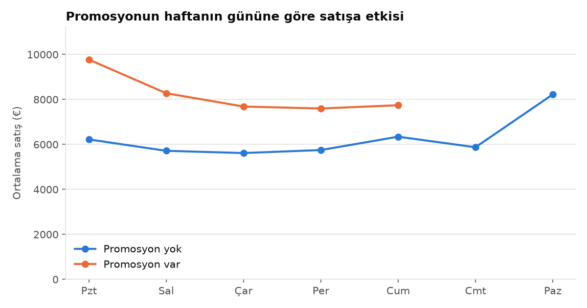
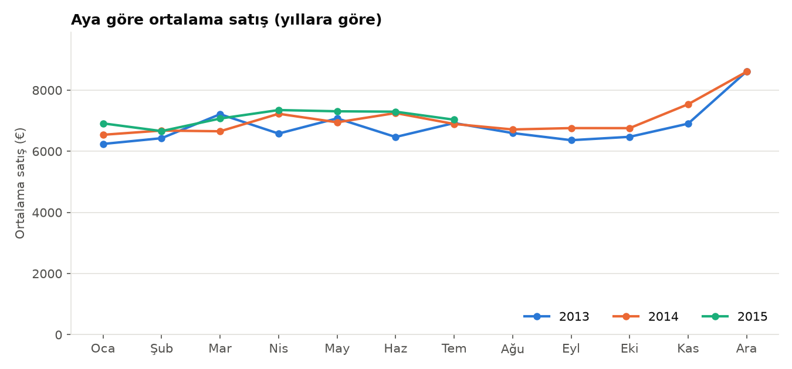
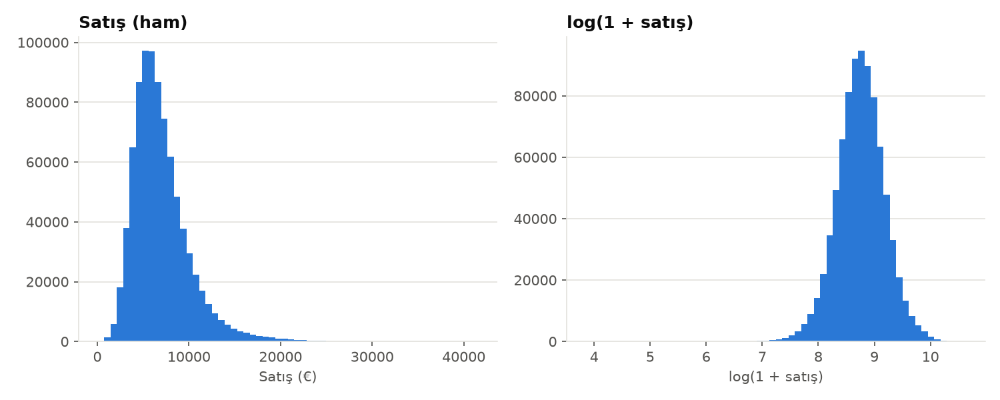

# PricePrediction · Mağaza Satış Tahmini

Fırat Üniversitesi Bilgisayar Mühendisliği Tasarım dersi kapsamında yürütülen takım projesi. Amaç, [Rossmann Store Sales](https://www.kaggle.com/c/rossmann-store-sales) verisiyle 1.115 mağazanın günlük satışlarını tahmin etmek.

Bu repo şu an iki aşamayı içeriyor: **veri hazırlama** ve **keşifsel veri analizi (EDA)**. Modelleme bir sonraki aşama.

> **English:** Team project on the Rossmann Store Sales dataset (1,115 stores, ~1M daily records). This repo currently covers data preparation (leak-free features, log-transformed target, MAD-based outlier flags) and exploratory analysis with 10 charts and an auto-generated findings report. Modelling is the next stage.

<p align="center">
  
</p>

## Aşamalar

**1. Veri hazırlama** · [`01_veri_hazirlama.py`](01_veri_hazirlama.py)

- Kapalı (`Open=0`) ve satışı sıfır olan günler eğitimden çıkarılır; bu günler için tahmin 0 atanır.
- `CompetitionDistance` eksikleri "yakında rakip yok" anlamında büyük bir değerle doldurulur; eksik rakip açılış tarihleri ayrı bir kategori olur.
- Kategorik değişkenler sayısal kodlara çevrilir.
- Hedef değişkene `log(1 + Sales)` uygulanır.
- Aykırı değerler mağaza bazında MAD ile işaretlenir ama silinmez.
- `Customers` kullanılmaz: tahmin anında bilinmez, kullanılırsa veri sızıntısı olur.
- Çıktı olarak işlenmiş veri ve bir veri kalite raporu üretilir.

**2. Keşifsel analiz** · [`02_eda.py`](02_eda.py)

10 grafik üretir ve [`bulgu_ozeti.md`](bulgu_ozeti.md) dosyasını verideki gerçek sayılardan otomatik yazar.

## Öne çıkan bulgular

Aşağıdaki karşılaştırmalar betimleyicidir, nedensellik iddiası taşımaz.

- **Promosyon:** promosyonlu günlerde ortalama satış %38,8 daha yüksek (8.229'a karşı 5.930).
- **Mevsimsellik:** en güçlü ay Aralık, en zayıf ay Eylül. Pazar günü mağazaların yalnızca %2,5'i açık.
- **Rekabet:** rakip mesafesi ile mağaza satışı arasında neredeyse ilişki yok (Spearman −0,03).
- **Hedef dağılımı:** log dönüşümü çarpıklığı 1,59'dan −0,11'e indiriyor; modelde log hedef kullanılmasının gerekçesi bu.
- **Veri boşluğu:** 2014'ün ikinci yarısında yaklaşık altı ay boyunca 180 mağazanın kaydı yok. Bu dönemde gecikmeli öznitelikler eksik kalıyor.

| | |
|---|---|
|  |  |
|  |  |

## Çalıştırma

[Kaggle](https://www.kaggle.com/c/rossmann-store-sales/data) sayfasından `train.csv` ve `store.csv` dosyalarını indirip `data/` klasörüne koy:

```bash
pip install -r requirements.txt
python 01_veri_hazirlama.py --veri-dir data --cikti-dir data/islenmis
python 02_eda.py --girdi-dir data/islenmis --cikti-dir eda_ciktilari
```

`pyarrow` kuruluysa işlenmiş veri Parquet, değilse sıkıştırılmış CSV olarak kaydedilir.
