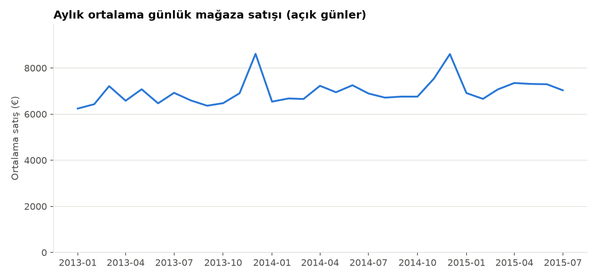
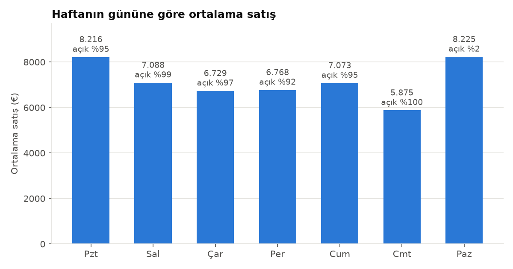
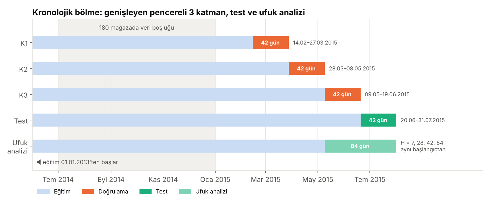
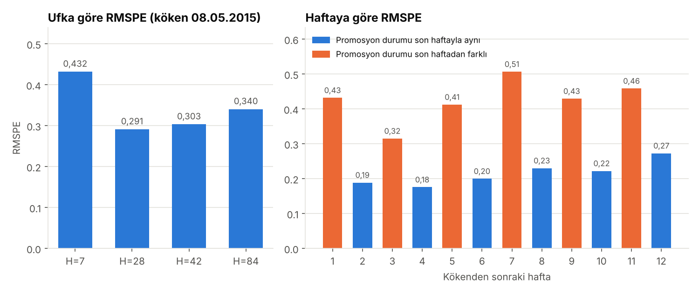

# PricePrediction · Mağaza Satış Tahmini

Fırat Üniversitesi Bilgisayar Mühendisliği Tasarım dersi kapsamında yürütülen takım projesi. Amaç, [Rossmann Store Sales](https://www.kaggle.com/c/rossmann-store-sales) verisiyle 1.115 mağazanın günlük satışlarını tahmin etmek.

Bu repo şu an dört aşamayı içeriyor: **veri hazırlama**, **keşifsel veri analizi (EDA)**, **ufka duyarlı öznitelik mühendisliği** ve **mevsimsel naive temel model**. Sırada LightGBM ve Prophet var.

> **English:** Team project on the Rossmann Store Sales dataset (1,115 stores, ~1M daily records). This repo covers data preparation (leak-free features, log-transformed target, MAD-based outlier flags), exploratory analysis with 10 charts, a horizon-aware feature pipeline (forecast horizon H as a single parameter, verified by an automatic leakage test) and a seasonal naive baseline (test RMSPE 0.349). LightGBM and Prophet come next.

<p align="center">
  
</p>

## Aşamalar

**1. Veri hazırlama** · [`01_veri_hazirlama.py`](src/01_veri_hazirlama.py)

- Kapalı (`Open=0`) ve satışı sıfır olan günler eğitimden çıkarılır; bu günler için tahmin 0 atanır.
- `CompetitionDistance` eksikleri "yakında rakip yok" anlamında büyük bir değerle doldurulur; eksik rakip açılış tarihleri ayrı bir kategori olur.
- Kategorik değişkenler sayısal kodlara çevrilir.
- Hedef değişkene `log(1 + Sales)` uygulanır.
- Aykırı değerler mağaza bazında MAD ile işaretlenir ama silinmez.
- `Customers` kullanılmaz: tahmin anında bilinmez, kullanılırsa veri sızıntısı olur.
- Çıktı olarak işlenmiş veri ve bir veri kalite raporu üretilir.

**2. Keşifsel analiz** · [`02_eda.py`](src/02_eda.py)

10 grafik üretir ve [`bulgu_ozeti.md`](raporlar/bulgu_ozeti.md) dosyasını verideki gerçek sayılardan otomatik yazar.

**3. Öznitelik mühendisliği** · [`03_oznitelik_muhendisligi.py`](src/03_oznitelik_muhendisligi.py)

- Tahmin ufku `H` tek bir parametredir (`--ufuk`, varsayılan 42 gün); dört ufuk (7, 28, 42, 84) tek komutla üretilir.
- 2. haftadaki 17 özniteliğe 8 yeni öznitelik eklenir (toplam 25): promosyon bloğunun kaçıncı günü, en yakın resmî tatile kalan / tatilden geçen gün ve geçmiş satıştan türetilen 5 öznitelik.
- Geçmiş satış öznitelikleri en az `H` gün gecikmelidir; `t` günü için yalnızca `t−H` ve öncesi kullanılır.
- **Sızıntı testi:** kesim tarihinden sonraki satışlar rastgele değiştirilir; kesim + `H` gününe kadar hiçbir öznitelik değişmemelidir. 4 ufuk × 3 kesim = 12 testin hepsi geçer.
- Sonuçlar: [`oznitelik_raporu.md`](raporlar/oznitelik_raporu.md). Bağımsız kontrol: [`kontrol_oznitelikler.py`](src/kontrol_oznitelikler.py).

**4. Mevsimsel naive temel model** · [`04_temel_model.py`](src/04_temel_model.py)

- Son gözlenen hafta, ufuk boyunca tekrarlanır; kapalı günlerin tahmini 0'dır.
- Üç çapraz doğrulama katmanı, test dönemi (20.06–31.07.2015) ve 08.05.2015 kökenli ufuk analizi için hata hesaplar.
- Sonuçlar: [`temel_model_ozeti.md`](raporlar/temel_model_ozeti.md).

Ortak tarih bölmeleri ve hata ölçütleri [`ortak.py`](src/ortak.py) dosyasındadır.

## Öne çıkan bulgular

Aşağıdaki karşılaştırmalar betimleyicidir, nedensellik iddiası taşımaz.

- **Promosyon:** promosyonlu günlerde ortalama satış %38,8 daha yüksek (8.229'a karşı 5.930).
- **Mevsimsellik:** en güçlü ay Aralık, en zayıf ay Eylül. Pazar günü mağazaların yalnızca %2,5'i açık.
- **Rekabet:** rakip mesafesi ile mağaza satışı arasında neredeyse ilişki yok (Spearman −0,03).
- **Hedef dağılımı:** log dönüşümü çarpıklığı 1,59'dan −0,11'e indiriyor; modelde log hedef kullanılmasının gerekçesi bu.
- **Veri boşluğu:** 2014'ün ikinci yarısında yaklaşık altı ay boyunca 180 mağazanın kaydı yok. Bu dönemde gecikmeli öznitelikler eksik kalıyor.
- **Temel model:** mevsimsel naive yöntemin test RMSPE'si 0,349. Ana modelin %30 iyileşme hedefi için test RMSPE'si en fazla 0,245 olmalı.
- **Promosyon döngüsü:** promosyonlar zincir genelinde ve iki haftalık döngüyle uygulanıyor. Naive yöntem, promosyon durumu son haftayla aynı olan günlerde 0,148, farklı olan günlerde 0,513 RMSPE veriyor.

| | |
|---|---|
|  |  |
|  |  |
|  |  |

## Proje yapısı

```
PricePrediction/
├── src/                          # kodlar (sırayla çalıştırılır)
│   ├── 01_veri_hazirlama.py
│   ├── 02_eda.py
│   ├── 03_oznitelik_muhendisligi.py
│   ├── 04_temel_model.py
│   ├── ortak.py                  # tarih bölmeleri, hata ölçütleri, grafik stili
│   └── kontrol_oznitelikler.py   # bağımsız kontrol
├── gorseller/
│   ├── eda/                      # 01–10: keşifsel analiz grafikleri
│   └── model/                    # 11–14: bölme şeması ve temel model grafikleri
├── raporlar/                     # kodların ürettiği bulgu ve sonuç özetleri
├── data/                         # Kaggle verisi (repoya girmez)
├── requirements.txt
└── README.md
```

## Çalıştırma

[Kaggle](https://www.kaggle.com/c/rossmann-store-sales/data) sayfasından `train.csv` ve `store.csv` dosyalarını indirip `data/` klasörüne koy:

```bash
pip install -r requirements.txt
python src/01_veri_hazirlama.py --veri-dir data --cikti-dir data/islenmis
python src/02_eda.py --girdi-dir data/islenmis --cikti-dir eda_ciktilari
python src/03_oznitelik_muhendisligi.py --girdi-dir data/islenmis --cikti-dir data/oznitelikler
python src/04_temel_model.py --girdi-dir data/islenmis --cikti-dir model_ciktilari
python src/kontrol_oznitelikler.py      # isteğe bağlı bağımsız kontrol
```

`pyarrow` kuruluysa işlenmiş veri Parquet, değilse sıkıştırılmış CSV olarak kaydedilir.
